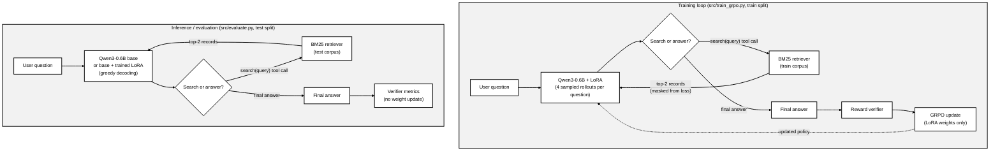

# SearchLite-RL: Reinforcement Learning for an LLM-Based Search Agent

## Project Overview

SearchLite-RL is a small pilot project that asks whether reinforcement learning can improve how a
small language model **decides when to search**, **uses retrieved evidence**, and **produces correct
answers**. A Qwen3-0.6B agent answers questions about fictional research projects. Some questions
state the needed fact directly. Others can only be answered by calling a local search tool. The
agent is trained with GRPO using a verifiable outcome reward.

The project is inspired by [Search-R1](https://arxiv.org/abs/2503.09516) but is **not** a
reproduction of the full Search-R1 framework. It uses one small model, a local BM25 retriever over a
synthetic corpus, short episodes, and the off-the-shelf Hugging Face TRL trainer, with no veRL,
PPO critic, Wikipedia index, or live web search.

## System Architecture



The policy makes at most **2 searches** per episode before it must give a final answer.

**Main components**

| Component | File | Role |
|---|---|---|
| Data generator | `data/generate.py` | Builds fictional entities, a separate corpus per split, and lookup / no-search questions from a fixed seed |
| BM25 retriever | `src/search_tool.py` | Deterministic top-2 search over one split's corpus |
| Environment | `src/environment.py` | `SearchEnv` exposes the `search` tool, enforces the 2-call cap, and tracks searches per rollout. Also contains the greedy evaluation episode loop |
| Reward verifier | `src/reward.py` | Parses `<answer>…</answer>`, checks normalized exact match, and applies search and invalid-action costs |
| GRPO trainer | `src/train_grpo.py` | TRL `GRPOTrainer` with `environment_factory` (one `SearchEnv` per rollout) and a PEFT LoRA adapter |
| Evaluation | `src/evaluate.py` | Runs the base model or the trained adapter on identical held-out tasks |
| Plots | `src/plot_metrics.py` | Loss, reward, correctness and search-rate curves, drawn from logged training metrics only |
| Traces | `src/trace_schema.py` | One JSONL record per episode: messages, tool calls, retrieved doc IDs, reward |

## Technology Stack

| Technology | Use |
|---|---|
| Python 3.11 | Runtime |
| Qwen3-0.6B (`Qwen/Qwen3-0.6B`) | Policy model, run in non-thinking mode with its native tool-call template |
| PyTorch | Tensor and autograd backend (CUDA, or Apple Silicon MPS) |
| Hugging Face Transformers | Model and tokenizer loading, chat templates, generation |
| Hugging Face TRL | `GRPOTrainer`: multi-turn tool rollouts, tool-token loss masking, GRPO optimization |
| GRPO | Group Relative Policy Optimization, a critic-free policy-gradient method |
| PEFT / LoRA | Trainable low-rank adapter (r=8, alpha=16, on `q_proj` and `v_proj`) |
| rank-bm25 | BM25 (Okapi) lexical retrieval |
| Hugging Face Datasets / Accelerate | Training dataset wrapper and trainer runtime (TRL dependencies) |
| PyYAML | Experiment configuration |
| pandas, matplotlib | Metric loading and plotting |
| pytest | Pre-training test suite |

Exact tested versions are pinned in `requirements.lock`.

## Project Structure

```
.
├── README.md
├── requirements.txt          # direct dependencies
├── requirements.lock         # exact tested versions
├── run_main.sh               # tests → main training → base/trained evaluation → plots
├── configs/
│   └── train.yaml            # model, LoRA, GRPO and smoke-test settings
├── data/
│   ├── generate.py           # deterministic dataset + corpus generator
│   ├── manifest.json         # seed, split sizes, corpus hashes
│   ├── {train,dev,test}_tasks.jsonl
│   └── {train,dev,test}_corpus.jsonl
├── src/
│   ├── search_tool.py        # BM25 retriever
│   ├── environment.py        # SearchEnv tool environment + evaluation episode loop
│   ├── reward.py             # verifier and reward
│   ├── train_grpo.py         # GRPO + LoRA training
│   ├── evaluate.py           # held-out evaluation
│   ├── plot_metrics.py       # training curves
│   └── trace_schema.py       # episode trace format
└── tests/
    ├── test_data.py          # split isolation and label-leakage checks
    ├── test_retriever.py     # determinism, bounds, oracle recall@2
    ├── test_reward.py        # reward arithmetic and answer parsing
    └── test_tool_loop.py     # tool runtime, call cap, trace integrity
```

Running the scripts writes everything to `outputs/<run_id>/`, which is not tracked in git.

## How to Install and Run

**1. Clone the repository**

```bash
git clone https://github.com/aasritha-oql7872/Pilot-project.git
cd Pilot-project
```

**2. Create and activate a Python 3.11 environment**

```bash
python3.11 -m venv .venv
source .venv/bin/activate
```

**3. Install dependencies**

```bash
pip install --upgrade pip
pip install -r requirements.lock      # exact tested versions (or: pip install -r requirements.txt)
```

**4. Generate the dataset** (optional, because the generated files are already committed. Re-running with the
same seed reproduces them byte for byte.)

```bash
python -m data.generate --seed 42 --train 240 --dev 60 --test 100
```

**5. Run the automated tests**

```bash
python -m pytest -q
```

**6. Run the GRPO smoke test** (3 optimizer steps, written to `outputs/smoke/`)

```bash
python -m src.train_grpo --config configs/train.yaml --smoke
```

The first run downloads `Qwen/Qwen3-0.6B` (~1.5 GB) from the Hugging Face Hub. No access token is
needed. The smoke test has been run on an Apple Silicon Mac (MPS) and took a few minutes.

**7. Run the main training experiment** (60 optimizer steps, written to `outputs/main/`. A CUDA GPU
is recommended.)

```bash
python -m src.train_grpo --config configs/train.yaml --output outputs/main
```

**8. Evaluate the base and trained models** on the same 100 held-out test tasks

```bash
python -m src.evaluate --checkpoint base --split test --output outputs/main/eval_base.json
python -m src.evaluate --checkpoint outputs/main/adapter --split test --output outputs/main/eval_trained.json
```

The second command requires `outputs/main/adapter/`, which step 7 produces.

**9. Generate the training loss and reward plots** (requires `outputs/main/train_metrics.csv` from step 7)

```bash
python -m src.plot_metrics --run outputs/main --output outputs/main/figures
```

Steps 5 and 7–9 can also be run in one go with the environment activated: `bash run_main.sh`.

## Training and Evaluation

**GRPO objective.** For each training question the trainer samples a group of 4 rollouts at
temperature 0.7 and scores each one with the verifier. Each rollout's advantage is its reward
relative to the group: (R − mean) / std. TRL then applies a clipped policy-gradient update to the
LoRA weights. Only model-generated tokens are optimized: TRL masks retrieved tool text out of the
loss. Settings are in `configs/train.yaml`: learning rate 5e-5, 16 rollouts per step, 256-token
budget per episode (generated + tool tokens), and no KL penalty (`beta: 0.0`).

**Reward.**

```
R = 1.0 · correct − 0.05 · N_search − 0.10 · N_invalid
```

* `correct`: the text inside `<answer>…</answer>` matches the gold answer after normalization
  (lowercased, punctuation and the words "the" and "project" removed).
* `N_search`: searches the environment actually executed.
* `N_invalid`: tool calls that failed or were not executed (bad arguments, unknown tool, over the
  2-call cap), plus 1 if the final answer is missing or malformed.

**Search tool.** The model calls `search(query)` through Qwen3's native `<tool_call>` format. The
environment ranks the current split's corpus with BM25 after lowercasing, stopword removal and
light suffix stemming. It returns the top-2 records (≤300 characters each, prefixed with their
document IDs) as a tool message, and generation then resumes. A tool error is returned to the model
as a message and counted as invalid.

**Data isolation.**

* Train, dev and test each have their own entities and their own corpus. Training rollouts can
  only search the train corpus, and evaluation swaps in the test corpus.
* No-search questions state the fact in the prompt, and their entities are never indexed. Lookup
  answers appear only in the corpus, never in the question.
* Gold labels are stored as task metadata visible only to the environment and the verifier, never
  to the model.
* The dev split is never used for training.
* `tests/test_data.py` enforces these rules, and `tests/test_retriever.py` checks ≥95% oracle
  recall@2.

**Metrics and artifacts** (in `outputs/<run_id>/`)

| Artifact | Contents |
|---|---|
| `train_metrics.csv` | Per optimizer step: policy loss, mean reward, reward std, tool-call frequency, correctness, searches and invalid actions per episode |
| `trajectories.jsonl` | Every training rollout: messages, tool calls, retrieved doc IDs, final answer, reward |
| `eval_base.json`, `eval_trained.json` | Accuracy (overall / lookup / no-search), search-decision accuracy, mean searches, invalid rate, completion rate, evidence recall@2, mean reward, plus every evaluation episode |
| `figures/*.png` | Loss, reward, correctness and searches vs. optimizer step |
| `adapter/` | Trained LoRA adapter |
| `config_snapshot.yaml`, `system_info.txt` | Exact config, package versions, hardware, peak VRAM, LoRA weight-change check, corpus hash |

**Current status.** The pipeline has been checked end to end with the 3-step smoke test: real
GRPO updates ran and the LoRA weights changed. The 60-step main experiment has not been run yet, so
this README reports no performance results.

## References

* Jin et al., *Search-R1: Training LLMs to Reason and Leverage Search Engines with Reinforcement
  Learning*: [paper](https://arxiv.org/abs/2503.09516) · [code](https://github.com/PeterGriffinJin/Search-R1)
* Hugging Face TRL, GRPO Trainer: <https://huggingface.co/docs/trl/grpo_trainer>
* Shao et al., *DeepSeekMath: Pushing the Limits of Mathematical Reasoning in Open Language Models*
  (introduces GRPO): <https://arxiv.org/abs/2402.03300>
